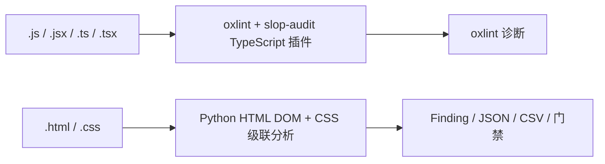

# HTML/CSS 结构分析与 oxlint 插件分工计划

## 1. 背景与变更来源

在 `src/` 下新建 TypeScript 目录 `src/slop-audit/`，用 TypeScript 写 oxlint 插件

| 路径 | 最终职责 |
| --- | --- |
| TypeScript oxlint 插件 | 负责 `.js` / `.jsx` / `.ts` / `.tsx` 中可由 JS/TS/JSX AST 表达的规则 |
| tree-sitter | 负责 `.html`、页面内 `<style>`、本地 CSS，以及 DOM/CSS 级联相关规则 |

关键技术约束：oxlint 的 JS 插件当前主要覆盖 JS/JSX/TS/TSX 的脚本 AST， HTML DOM 与最小 CSS 级联暂不能放进 oxlint 插件。

## 2. 已确定决策

- 在 `src/` 下新建 TypeScript 插件目录 `src/slop-audit/`。
- 根目录 `package.json` 作为 pnpm workspace 根包，`src/slop-audit/` 作为 workspace 包。
- 插件以 TypeScript 编写，使用 `@oxlint/plugins` 的 `definePlugin` / `defineRule` 或等价的 ESLint v9 兼容 Rule API。
- 插件命名空间使用 `slop-audit/<rule-name>`，避免与 oxlint 内置插件冲突。
- 第一阶段插件只迁移能在 JS/TS/JSX/TSX AST 上可靠表达的规则。
- Python 侧继续沿用 `src/unslop_audit/`，新增 HTML grammar、CSS grammar 与最小 CSS 级联，专门覆盖 oxlint 不分析的 HTML/CSS 范围。
- 文件归属优先按扩展名划分：`.ts/.tsx/.js/.jsx` 由插件报告；`.html/.css` 由 Python 报告。
- 依赖 DOM/CSS 级联的规则一律由 Python 实现；插件只处理静态 AST 可判定部分。
- 同一文件、同一规则只启用一条路径，避免双跑重复计数。
- TypeScript 插件与 Python 分析各自输出各自结果，不做跨工具汇总。
- 不引入浏览器，不读取渲染结果，不执行页面脚本。
- 不实现类型感知规则；不支持的 SFC 模板和 SCSS 不纳入第一阶段。
- 不删除或废弃现有 Python CLI；其行为是迁移基线和过渡实现。

## 3. 总体设计

### 3.1 双路径输入模型

同一项目中的文件按能力边界进入不同分析路径：



插件不构造 DOM，不读 CSS 文件；Python 不扩展新的 TSX AST 规则实现，只在既有 TSX 能力上保持基线。两条路径按文件归属独立运行、独立输出，不互相写入对方结果。

### 3.2 oxlint 插件形态

插件目录：

```text
src/slop-audit/
  package.json
  tsconfig.json
  src/index.ts
  src/rules/
  src/helpers/
  tests/
```

- `package.json` 声明插件包元信息、构建脚本、测试脚本和运行时依赖。
- 根目录 `package.json` 是 pnpm workspace 根包；实施时新增根 `pnpm-workspace.yaml` 纳入 `src/slop-audit/`。
- `src/index.ts` 导出插件对象，包含 `meta.name` 与规则表。
- `src/rules/` 每条规则一个模块，遵循 ESLint 风格的 `create(context)` 或 `createOnce(context)`。
- `src/helpers/` 放 AST 取值、类名拼接、静态样式文本解析与文案节点判定逻辑。
- 构建产物供 `.oxlintrc.json` 的 `jsPlugins` 引用；路径相对配置文件解析。

配置示例：

```jsonc
{
  "jsPlugins": ["./src/slop-audit/dist/index.js"],
  "rules": {
    "slop-audit/arbitrary-spacing": "warn",
    "slop-audit/tw-purple-gradient": "error"
  }
}
```

规则名必须在配置中显式列出；未知规则名会导致配置失败。插件命名空间不得与内置插件名冲突。

### 3.3 插件 AST 视图

插件不构造独立 AST，直接使用 oxlint 提供的 ESLint 兼容 AST 与 `SourceCode`：

- 使用 visitor 处理 JSX/TSX 节点，例如 `JSXElement`、`JSXAttribute`、`JSXText`、`Literal`、`TemplateLiteral`、`CallExpression`、`Property`。
- 复用 `node.parent` 和 `context.sourceCode.getAncestors()` 判断 JSX 元素关系，不自己维护 HTML DOM 树。
- 对 `className` / `class`、`style={{ ... }}`、`css` prop、模板字符串中的静态片段做保守解析。
- 识别 `cx`、`clsx`、`classnames`、`cn`、`classNames` 等类名拼接函数；无法静态求值的表达式跳过。
- 所有报告位置来自 AST 节点的 `loc`，不构建字节偏移映射。
- 文案规则只检查 JSXText、静态字符串和可静态解析的属性，避免扫描无关代码。

### 3.4 Python HTML DOM 与 CSS 级联

Python 侧保留原 HTML/CSS 计划的核心能力：

- HTML 解析使用 `tree-sitter` HTML grammar；CSS 解析使用 `tree-sitter` CSS grammar。
- 节点树保留标签名、属性、文本节点、父子关系、源码字节范围、字节到字符偏移映射和行号。
- 注释节点不参与规则匹配，但保留原文位置以保证偏移对齐。
- 样式来源包括元素内联样式、页面内样式块、可静态定位的项目内本地样式表。
- 最小级联支持元素/类/ID 选择器、静态声明、内联样式 > ID > 类 > 元素、源码顺序覆盖、`!important` 优先，以及有限属性继承。
- 明确不做媒体查询、伪类、伪元素、层叠层、属性选择器、复杂组合选择器、变量展开、布局计算、真实尺寸与对比度采样。

结构路径失败时不应使 CLI 崩溃：可回退到文本路径，并把提示写日志侧，不污染结构化输出。

### 3.5 规则归属

| 层级 | 规则类型 | oxlint 插件 | Python |
| --- | --- | --- | --- |
| A：静态 AST 规则 | Tailwind 类名、静态 `className`、JSX 文案、静态字符串、JSX 元素结构、可访问名称 | 主责 | 保留 HTML 文本路径 |
| B：静态样式文本 | JS/TS 内的 `style` 对象、静态模板 CSS 片段 | 受限实现，默认不启用 | 主责 |
| C：HTML/CSS 文件规则 | `.html` / `.css`、内联样式、样式块、本地样式表 | 不实现 | 主责 |
| D：DOM/CSS 级联规则 | 元素关系、层级结构、计算样式、嵌套圆角/边框/间距模式 | 不实现 | 主责 |
| E：类型感知/SFC/SCSS | 依赖 TypeScript 类型、Vue/Svelte/Angular 模板、SCSS | 不实现 | 第一阶段不实现 |

首批插件规则只选 A 层；B 层需先明确静态解析边界并通过正反例后才启用。Python 侧新增规则以低严重级别接入，观察误报后再决定是否提升。

### 3.6 独立输出

- TypeScript 插件的发现由 oxlint 自己输出，使用 oxlint 的规则名、严重级别、消息和位置。
- Python 分析的发现继续使用现有 CLI 的 `Finding`、JSON、CSV 和 `--fail-on` 门禁。
- 两侧报告各自独立，不做严重级别映射、维度映射、字段转换或跨工具去重。
- Python JSON stdout 保持纯净，CSV 列和 `--fail-on` 语义不回归。
- 文件归属规则用于避免同一文件被两侧重复分析，不用于生成统一报告。

### 3.7 与现有规则的关系

- 文本规则继续负责纯文本模式，例如文案、emoji、类名片段、CSS 声明文本。
- 插件规则负责 JS/TS/JSX/TSX 的静态 AST 表达。
- Python 结构规则负责 HTML DOM、CSS 级联和计算样式。
- 不改变维度顺序、报告字段、CSV 列和门禁语义。
- 迁移期 Python CLI 继续作为行为基线；插件命中需与旧 CLI 在 TSX 用例上对比。

## 4. 不做的事

- 不在插件内解析 HTML/CSS 文件。
- 不把 HTML DOM/CSS 级联从 Python 侧移除。
- 不扩展 Python 侧新的 TSX AST 规则实现；TSX 新实现以插件为准。
- 不实现浏览器渲染、运行时样式读取、截图判断或人工设计判断。
- 不实现 TypeScript 类型感知规则。
- 不实现 SFC 模板和 SCSS 的第一阶段支持。
- 不在未批准前修改干净样本以迁就新规则。
- 不在本计划中删除 Python CLI 或改变现有 JSON/CSV/门禁语义。
- 不做 oxlint 诊断与 Python finding 的跨工具汇总、转换或统一去重。

## 5. 验收标准

- `src/slop-audit/` 可安装依赖、类型检查、构建，并输出可被 oxlint 加载的插件入口。
- `.oxlintrc.json` 能识别 `slop-audit` 命名空间和全部已启用规则，oxlint 启动不报未知规则。
- A 层规则均有 TypeScript 正反例和位置断言；B 层规则未经批准不启用。
- HTML grammar 与 CSS grammar 可正常导入并解析现有样本。
- HTML 节点和 CSS 声明的源码位置能稳定映射回源文件行号。
- 注释、内联样式、样式块、本地样式表都能进入 Python 结构分析。
- 最小级联对优先级、顺序、`!important` 和继承有可验证的正反例。
- 新增 DOM/样式规则每条都有正反例，且报告行号落在源文件范围内。
- oxlint 诊断由 oxlint 独立输出；Python 发现由 Python CLI 独立输出，两者互不写入对方结果。
- 现有文本规则、TSX 规则、JSON 纯净性、CSV 列、`--fail-on` 行为不回归。
- 干净样本零命中的基线不被破坏；若新规则导致命中，必须先确认规则边界或样本调整。
- 文档只补原理，不写目录、文件名、函数名或行号。

## 6. 风险与对策

| 风险 | 对策 |
| --- | --- |
| oxlint JS 插件仍是 alpha，API 可能变化 | 锁定 oxlint 与 `@oxlint/plugins` 版本范围，升级时先跑兼容性检查 |
| 插件只能看到 JS/TS/JSX/TSX AST | 按能力边界分工，HTML/CSS 明确交给 Python |
| 未知规则名导致整个配置失败 | 用 `oxlint --rules --format json` 核对规则名，并保留最小配置冒烟检查 |
| `context` 跨文件复用导致状态泄漏 | 避免在规则闭包中保存文件级状态；需要时使用 `createOnce` + 按文件重置 |
| 单条规则抛异常影响整个文件的插件诊断 | 规则内部保守处理未知 AST，避免抛出；测试加入异常形状用例 |
| grammar 节点结构与预期不一致 | 先用临时探针确认节点类型、字段和偏移量，再实现解析层 |
| CSS 级联范围过小导致规则误报 | 只启用能被最小级联可靠支撑的规则，复杂样式规则延期 |
| 类名启发式导致卡片/kicker 误报 | 规则先低严重级别，配合正反例收紧条件 |
| 两侧报告口径不同 | 明确独立输出，不互相对齐字段或严重级别 |
| 双跑导致重复计数 | 同一文件、同一规则只启用一条路径，并在状态文件记录切换清单 |
| 外部样式读取扩大扫描边界 | 只读取可静态定位的本地样式表，并限制在项目内 |
| 依赖版本不兼容 | grammar 与 Node 依赖都先探针验证，再锁定版本 |
