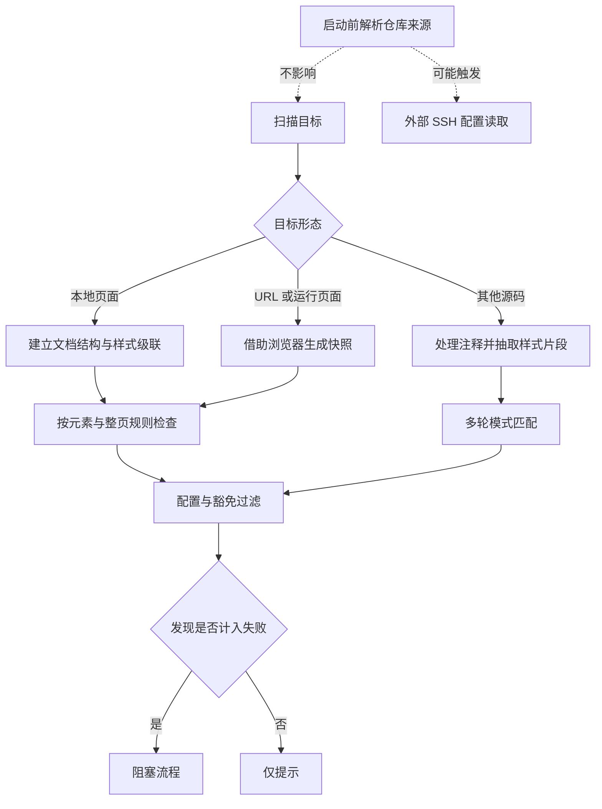

# impeccable

## 1. impeccable 的机制判断

### 1.1 它不是单一正则器

对本地页面文件，它建立真实的文档结构与样式级联，再按元素和整页两个层次检查；对其余源码文件，它先处理注释、抽出样式片段，再做多轮模式匹配。

因此两类输入的能力并不对称：页面文件能利用元素关系与样式继承，源码文件只能依赖文本模式。判断它“能不能替代某个静态检查”时，必须分开看这两条路径。

整体机制可以概括为：

- 本地页面：页面源码被解析成文档树，相当于建立语法树；样式声明经过级联形成每个元素的计算样式，相当于属性求值或环境传播；规则按元素与整页执行，相当于树上的模式匹配。
- 其他源码：注释剥离和样式片段抽取接近词法预处理，随后的多轮模式匹配接近基于模式的扫描器，没有构建语法树。
- 浏览器模式：浏览器先生成文档快照与计算样式，分析器再对快照做静态判定；输入更接近渲染结果，但规则阶段仍不是运行时语义分析。

### 1.2 浏览器模式与本地模式是两条路

URL 和已运行页面的检查会借助浏览器快照；本地文件检查不启动浏览器。这意味着本地扫描不依赖浏览器状态，但也看不到渲染后的真实样式与布局结果。

### 1.3 配置与设计上下文是过滤层

项目级配置、设计上下文和行内豁免会在扫描前后参与过滤。关闭这些配置时看到的是原始规则能力；保留它们时看到的是项目实际会采用的结论。同一份文件在不同配置下结果不同，是预期行为，不是检测不稳定。

### 1.4 门禁语义只有“阻塞 / 不阻塞”

它把发现分成会计入失败和仅作提示两类。提示类会展示但不阻塞流程；结构化结果和人类可读文本分流输出。这种模型比四级严重阈值简单，但也更难表达“轻微问题只提醒、明显问题才拦截”这类策略。

## 2. 差异点

| 差异点 | impeccable | 本工具的机制 | 实测例子与含义 |
| --- | --- | --- | --- |
| 页面分析深度 | 文档结构 + 样式级联，按元素和整页检查 | 等长屏蔽 + 模式匹配，保留原文坐标 | 脏页一侧 5 条、另一侧 78 条。前者更结构化，但只覆盖自己的规则集；后者更贴紧当前规则基线。 |
| 组件源文件语义 | 源码走文本与模式匹配，不解析动态类名或样式对象 | 语法树归一后复用同一套规则，未知值跳过 | 17 组样本里两侧共同命中只有 1 组 |
| 规则基线 | 包含拥挤内边距、嵌套卡片、常用字体等设计质量项 | 固定规则基线加表情图标兜底，按九个维度组织 | 干净页在本工具为零命中，在另一侧出现 4 条阻塞项。它们不是同一套“干净”的定义。 |
| 定位语义 | 部分文本发现没有源码行号 | 命中位置映射回原文行号 | 脏页排除无定位项后，共同命中 1 行；仅本工具命中 40 行，仅另一侧 0 行。重叠很小。 |
| 门禁语义 | 阻塞与提示两类，提示不拦截 | 四级严重度按阈值决定是否拦截 | 干净页一侧通过、另一侧阻塞。门禁接线方式不能直接互换。 |
| 输出契约 | 结构化结果之外支持代码扫描平台注释格式；不提供固定四列明细或文本门禁标记 | 结构化结果 + 固定四列明细 + 文本门禁标记 | 两侧都能被脚本解析，但审阅表格和门禁文本只有本工具提供。 |
| 注释与豁免 | 项目配置、设计上下文、行内豁免指令参与过滤 | 注释按等长空白屏蔽；测试标记不是豁免指令 | 干净页在本工具零命中，是因为合规写法加注释屏蔽；换到另一侧仍会被它自己的规则阻塞。 |
