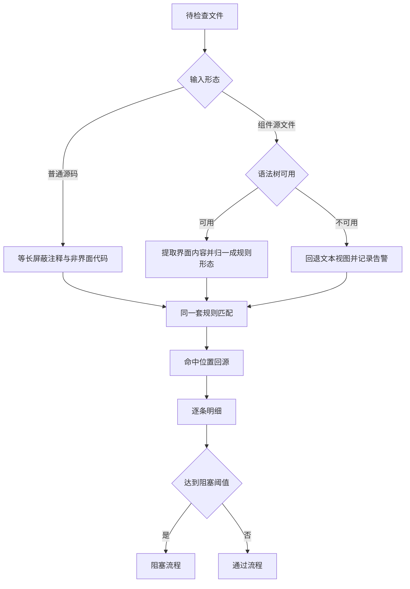

# unslop-audit 的设计意图与边界

**规则与输入形态解耦**: 规则只描述“找什么、为什么是问题、怎么改”，不关心输入来自哪种文件。

- 词法层：注释和非界面代码被等长空白替换，相当于跳过无用片段但保留位置信息，使后续报告仍能定位原文。
- 语法层：组件源文件先被解析成语法树，再挑选界面相关节点；这一步把字符流变成结构化表示，而不是在文本上直接猜。
- 语义层：只对少量可确定的表达式做局部求值，类似常量折叠与属性求值；未知表达式不展开，因此不是完整语义分析。
- 中间表示：界面节点被改写成规则可消费的统一形态，相当于把不同语法降低到简化表示；规则面向该表示，而不面向具体语法。
- 源映射：改写后的片段保留回源偏移，命中后再映射回源文件行号，作用类似源映射信息。

## 2. 关键设计决策

### 2.1 用等长屏蔽换准确行号

注释和非界面代码不是删掉，而是按原长度替换成空白并保留换行。这样命中位置可以直接对应到原文行号，报告不会出现“规则对了但行号错了”的问题。

代价是只对可客观识别的注释与非界面区域生效；它不追求完整理解业务代码，也不试图判断注释里的自然语言是否违规。

### 2.2 组件源文件被归一成规则能消费的形态

对组件源文件，先按语法树找出真正会出现在界面上的内容，再改写成规则已经熟悉的形态：类名、样式声明、可见文本。每条改写后的内容都保留回源位置，因此命中仍能报在源文件的真实行上。

表达式解析采取保守策略：能确定的字面量、本文件常量和有限的常见拼接形式才纳入；不确定的值宁可跳过，也不猜。这个选择优先保证低误报，而不是追求全覆盖。

### 2.3 降级优先于中断

语法树不可用时，自动退回文本视图，并把异常提示写到日志而不是结构化结果里。这样 CI 不会因为解析器或依赖问题中断，也不会把机器可读输出污染成混合格式。

代价是降级态可能降低精度，例如原本被语法结构屏蔽的写法可能被当成普通文本命中。因此降级结果与正常结果不应被当作等价基线。

### 2.4 门禁与表格是工具约定

严重级别阈值决定哪些问题阻塞流程；固定四列表格是为了让人能逐条看到问题和修复建议。结构化结果与人类可读摘要分开放置，是为了让机器解析稳定。

## 3. 能力边界

- 不做渲染截图判断、视觉层级判断、对比度实测、圆角嵌套计算、表格行状态等需要真实布局的检查。
- 不判断 heavy / light / no slop 的程度，不选择方向，不安排九步修复顺序。
- 对动态组件写法只覆盖能静态确定的部分；未知值跳过是设计选择，不是遗漏。
- 降级态只保证“不崩溃、不污染输出”，不保证与正常态等价。

## 4. 验证基线

验证关注的是一个相对稳定的预期，而不是实现细节：

- 脏样本必须能把规则基线全部触发一遍，证明规则没有死掉。
- 干净样本必须零命中，并为每条规则提供一处合规写法，证明规则没有越过边界。
- 组件源文件样本要证明：注释不误报、行号落回源文件、未知动态写法不崩溃。
- 命令行层要证明：结构化输出纯净、表格字段完整、门禁按阈值阻塞。

另有一个只读对照脚本用于观察与其他工具的能力差异；它不参与门禁，也不改变上述基线。
